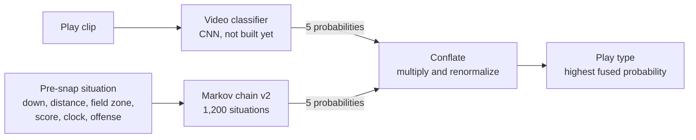

# Play-Type Markov Chain v2: One-Pager

October 14, 2026 · Ethan Huang

## What it does

The v2 Markov chain predicts the type of the upcoming play (run, pass, field goal, punt or other) from its pre-snap situation, using no video. Its probabilities are multiplied with the video classifier's to give the final prediction (paper Sections 4.2–4.3).

On the real 2017 FBS season it picks the right play type 64.8% of the time on its own, up from 54.3% for v1. Combined with a simulated 71%-accurate classifier, the full model reaches 87.3%, vs 84.8% with v1.

## How to use it

1. Clone the repo and install the packages: `pip install -r requirements.txt`.
2. Load a season of play-by-play. `download_cfb_pbp` fetches it once (about 72 MB) into `data/cfb_pbp/`.
3. Fit the model on past plays, then ask it about any pre-snap situation.

```python
from playByPlay import download_cfb_pbp, load_cfb_pbp
from markovChain import PlayMarkovChain

plays = load_cfb_pbp(download_cfb_pbp(2017))
mc = PlayMarkovChain().fit(plays)

situation = dict(offense='Georgia Tech', down=3, distance=8, yards_to_goal=65,
                 score_diff=0, half=1, period=2, seconds_left_half=600)
mc.next_play_type_proba(situation)   # [0.27, 0.70, 0.00, 0.00, 0.03] over R, P, F, U, O
mc.describe(situation)               # which bucket each indicator fell into
```

The notebook `notebooks/conflatedPlayPrediction.ipynb` runs the whole workflow end to end in about 3 minutes, and `python -m pytest tests -q` runs the 25 tests.

## How it fits into the full model

For each play clip, the video classifier and the Markov chain each give probabilities over the same five play types, and `conflate_probabilities` multiplies them into the final prediction.



The Markov chain never sees the video and the classifier never sees the game situation, so their mistakes rarely line up.

1. **Classifier:** run the play-type CNN on the clip. It isn't built yet, but the team repo's `notebooks/preSnapDetection.ipynb` already finds each clip's pre-snap frame. Its output must be in the order R, P, F, U, O.
2. **Situation:** get the play's pre-snap fields: offense, down, distance, yards to goal, score difference, half, quarter and seconds left in the half. For recorded games, look the play up in the play-by-play data; for live games, they would come from the scoreboard.
3. **Markov chain:** call `next_play_type_proba` on that situation.
4. **Conflate:** multiply the two vectors. The highest value is the predicted play type.

```python
from markovChain import PlayMarkovChain, team_run_rates
from conflation import conflate_probabilities

CLASSES = ('R', 'P', 'F', 'U', 'O')   # must match the classifier's output order

# train on games before the ones being predicted; team tendency from the latest season
mc = PlayMarkovChain().fit(past_plays, run_rates=team_run_rates(last_season_plays))

def predict_play(clip_probs, situation):
    mc_probs = mc.next_play_type_proba(situation, play_types=CLASSES)
    fused = conflate_probabilities([clip_probs, mc_probs])
    return CLASSES[fused.argmax()], fused
```

## Prediction indicators: before vs now

v1 predicted from the play that just happened; v2 predicts from the situation the offense faces before the snap, and adds three indicators.

| Indicator | Before (v1) | Now (v2) |
| --- | --- | --- |
| Down | Previous play's down | Upcoming play's down, 1st–4th |
| Distance to go | Not used | 1, 2–3, 4–6, 7–10, 11+ yards |
| Field position | Previous play's, 10 buckets of 10 yards | Upcoming play's, 5 zones: red zone, opp 21–35, opp 36–49, own side, own deep |
| Previous play type | Core of the state | Off by default (optional) |
| Team tendency | Not used | Offense's run rate: pass-heavy (under 45%), balanced, run-heavy (60%+) |
| Score and clock | Not used | One combined indicator: normal, trailing late, leading late, end of 1st half |
| Situations modelled | 280 states (78,400 transitions) | 1,200 situations |
| Rare situations | Near-uniform guess | Falls back to the next-coarser situation |
| Play types predicted | 7, incl. PAT and kickoff | 5, matching the classifier |
| Trained on | Simulated games | 869 real FBS games (2017) |

- **Down matters most.** Dropping it raises log loss from 0.723 to 0.969; field zone (0.769) and distance (0.756) come next.
- **Previous play type is off** because it multiplies the situations by 7 for a 0.001 log-loss gain.
- **Team tendency** barely moves overall accuracy (64.2% to 64.8%) but lifts Georgia Tech from 71.8% to 80.3%.

## Open items before integration

- [ ] **Classifier output:** produce real CNN probabilities in R, P, F, U, O order. The 87.3% above uses a simulated classifier.
- [ ] **Clip-to-play matching:** clip names carry the year, game code and quarter (e.g. `2017_G6016_Q4_012`). A table mapping game codes to play-by-play games is needed to look up each clip's situation.
- [ ] **"Other" class:** in the play-by-play data it means pre-snap fouls; confirm the video labels mean the same, not ads or replays.
- [ ] **More training data:** add the 2014–2016 seasons (`load_cfb_pbp` takes a list), and use the previous season's run rates for any game being predicted.
